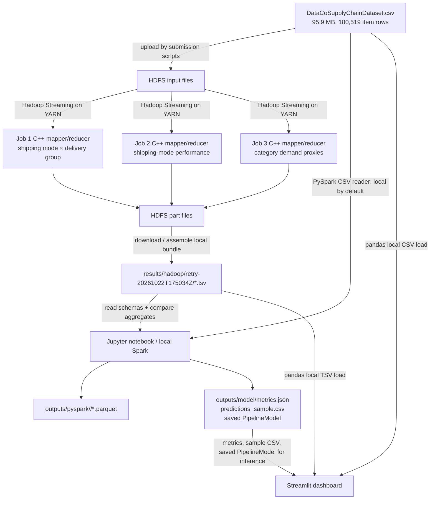

# Supply Chain Disruption and Inventory Risk Analysis Using Hadoop and PySpark

Technical guide to the implementation in this repository. This document describes the checked-in code, the saved notebook execution, the verified Hadoop result bundle, and the current dashboard. It does not claim this project measures inventory stockouts, shipping charges, supplier failure, or the causes of delays: the available data and code do not support those conclusions.

## 1. Project in one minute

The project uses the DataCo Smart Supply Chain dataset, a 95.9 MB ISO-8859-1 CSV with 180,519 order-item rows and 65,752 distinct orders. Three C++ mapper/reducer pairs run as Hadoop Streaming jobs on HDFS/YARN. They independently summarize delivery status by shipping mode, shipping-mode performance, and product-category demand. Their tab-separated outputs are downloaded into a local result bundle.

A Jupyter notebook uses PySpark in **local Spark mode** to load and clean the original CSV, create order-level and item-level analytics, compare its equivalent group counts with the downloaded Hadoop summaries, and train a decision-tree classifier for a binary target derived from delivery status. It saves Parquet summaries, model metrics, a sample-prediction CSV, and a Spark model artifact. The current Streamlit app reads the raw CSV and selected local result/model files to render interactive filtered views, an independent Hadoop verification view, and a single-order prediction form backed by the saved `PipelineModel`. It does not read HDFS directly and does not retrain the model.

The measured outcomes are delivery status, shipping duration and category/order-item demand proxies. There is no shipping-cost field or stock-on-hand field. `Sales` and `Order Item Total` are not shipping costs; quantity and sales are not inventory levels.

## 2. Architecture diagram



The Hadoop jobs are parallel summaries over the raw HDFS CSV; they are not a first stage whose aggregate output is subsequently used to train the classifier. The notebook reads the raw source separately and then loads the three Hadoop TSV files for cross-checking. Streamlit also reads the raw CSV independently. Data moves between Hadoop and the notebook/dashboard through local TSV files, not through a direct live service connection. The notebook can optionally read/write HDFS if environment variables enable that branch, but the recorded run used local Spark and the local raw CSV.

## 3. Repository structure

```text
Project/
├── cpp/
│   ├── csv.hpp                         shared parser/helpers for Jobs 2 and 3
│   ├── mapper/                         three mapper source files
│   ├── reducer/                        three reducer source files
│   └── bin/                            generated executables; ignored by Git
├── dashboard/
│   └── app.py                          current four-tab Streamlit application
├── data/
│   ├── DataCoSupplyChainDataset.csv    local source, about 95.9 MB, not tracked
│   └── DescriptionDataCoSupplyChain.csv optional local data dictionary
├── docs/
│   ├── DATASET.md                      input source, checksum, encoding, size
│   ├── SETUP_REPORT.md                 environment and historical verification
│   ├── WORKFLOW_LOG.md                 detailed setup/run transcript
│   └── PROJECT_TECHNICAL_GUIDE.md      this guide
├── notebooks/
│   └── supply_chain_analysis.ipynb     PySpark analysis and model notebook
├── outputs/
│   ├── pyspark/<run-id>/               local Parquet summary directories
│   └── model/                          metrics, sample predictions, model artifacts
├── results/
│   ├── <run-id>.tsv                    flat Job 1 compatibility result
│   └── hadoop/<run-id>/*.tsv           downloaded/assembled Hadoop result bundles
├── scripts/
│   ├── build_cpp.sh                    builds all six C++ programs
│   ├── check_schema.py                 resolves Job 1 CSV column positions
│   ├── check_job_schema.py             resolves Job 2/3 column positions
│   ├── run_streaming_job.sh             submits Job 1
│   ├── run_analysis_job.sh              submits Job 2 or Job 3
│   └── run_all_hadoop_jobs.sh           sequentially runs all three jobs
├── tests/expected/                     three full-data TSV fixtures
├── requirements.txt                    Python packages and pinned versions
├── README.md                           project operation and architecture notes
└── .gitignore                          excludes data, outputs, results, binaries, venv
```

The directory tree above omits `.venv/`, caches, generated Spark Parquet part/CRC files, and the large CSV itself. The raw dataset and result/output directories are intentionally ignored by Git. The expected TSV fixtures are small tracked reference files. There is no `pyproject.toml`, `environment.yml`, `Makefile`, or conventional pytest test module in the repository.

## 4. Technology choices

| Technology | Role here | Plain-language reason |
|---|---|---|
| C++ | Hadoop Streaming mapper/reducer processes | Small native programs parse CSV rows and perform the three narrowly defined aggregates. They run as ordinary executables on Hadoop workers, without embedding the analytics in a Java MapReduce class. |
| Hadoop HDFS + YARN + Streaming | Distributed file storage and MapReduce execution | HDFS stores the input/output; YARN schedules task processes; Streaming connects each task's stdin/stdout to the C++ programs. The shuffle sorts/groups mapper keys between mapper and reducer. |
| PySpark | Notebook data processing and ML | Spark DataFrames handle raw-data cleaning, multiple aggregations, joins/comparisons and model preparation. These are broader interactive analyses than the three fixed C++ jobs. |
| Jupyter Notebook | Interactive workflow and report | Provides ordered code/Markdown cells, visible schema/table outputs, and an execution record for exploring the dataset. Jupyter is the workbench; PySpark is the processing library used in it. |
| scikit-learn | **Not used** | The notebook trains a Spark ML `DecisionTreeClassifier` from `pyspark.ml`. No `sklearn` import or dependency appears. |
| Streamlit | Dashboard UI | Turns local data/results into a browser-based presentation with filters, KPIs, charts, verification tables, and downloads. |
| pandas | Dashboard file processing and notebook sample export | Dashboard uses `read_csv`/groupby and reads TSV outputs with pandas. Notebook calls `.toPandas()` for a 20-row prediction sample before saving CSV. |
| Plotly Express | Dashboard charts, if installed | Already in `requirements.txt`; the app falls back to Streamlit's native bar chart when Plotly cannot be imported. |

### C++ and Hadoop Streaming

Hadoop Streaming defines a simple process contract: Hadoop sends mapper input records to the executable's **standard input**; the mapper writes tab-separated key/value text to **standard output**. Hadoop captures that output, partitions it by key, sorts it, and sends the grouped values to reducer processes through their standard input. Reducers write final text rows to stdout, which Hadoop stores as `part-*` files in HDFS. Mapper/reducer diagnostics go to stderr so they do not pollute the data stream.

Hadoop reads/splits the HDFS input, starts mapper tasks, shuffles and sorts records by key, runs reducers, and persists reducer output. For this project the submit scripts request one reducer and set maximum split size to 32 MiB; the recorded 95 MB run used two map tasks and one reducer per successful job. This was a correctness run, not a performance benchmark.

The build script invokes `g++` with C++17, optimization and warning flags, plus static libstdc++/libgcc flags, and writes six executables into ignored `cpp/bin/`. The submission scripts pass the mapper and reducer executables using Hadoop Streaming's `-files` option, then name them with `-mapper`/`-reducer`. Header-derived zero-based source column indexes are passed through `-cmdenv` because only the HDFS split beginning at byte zero contains the CSV header. These scripts put Hadoop generic options such as `-files` before Streaming options such as `-cmdenv`.

Job 1 has its CSV parsing helpers embedded in `delivery_status_mapper.cpp`; Jobs 2 and 3 include the shared `cpp/csv.hpp`. The shared helpers handle quoted CSV delimiters, escaped quotes, CRLF, logical records containing quoted newlines, header normalization, numeric validation, and status normalization. The code treats the original ISO-8859-1 input as bytes for delimiter parsing; it does not transcode all fields to UTF-8. The actual source file has no embedded newlines, as recorded in the setup report, so Hadoop's line-oriented input splitting is compatible with this dataset. For another CSV containing records that span physical lines, Hadoop split boundaries would need particular care even though the C++ parser can join lines within one mapper process.

These jobs are useful beyond simply uploading a file: they actually transform order-item rows into grouped measures and de-duplicate order IDs where the metric is order-level. But they are fixed summaries, not a general-purpose inventory simulation or a full data warehouse.

### Why both Hadoop and PySpark?

The C++ jobs demonstrate low-level MapReduce aggregation using a manually controlled mapper/reducer contract on HDFS/YARN. The notebook uses Spark's higher-level DataFrame, SQL, RDD, and ML APIs for a more flexible analysis and classifier. Their overlap is deliberate in limited places: Hadoop summaries are compared with Spark recomputations to verify the distributed output. They are not a chained duplicate calculation where Spark consumes only Hadoop output. PySpark's main analytic tables and model are built from raw data loaded independently.

The notebook has an optional `BDA_USE_HDFS` input path and optional HDFS Parquet output path, but its recorded execution says `HDFS mode: False`, `Master: local[*]`, local raw CSV. The README/setup report confirm local Spark/Java 17, distinct from Hadoop's Java 8 runtime. No Spark-on-YARN execution is configured in this workflow.

### Why Streamlit?

The dashboard makes the local analytics usable in a live demo without requiring the audience to inspect notebook cells. It reads the supported CSV with pandas, computes filtered KPIs and summaries in process, loads Hadoop TSV files for an independent verification view, and loads saved JSON metrics/sample predictions. It can also restore the persisted Spark `PipelineModel` for a one-order prediction, but it does not read HDFS, the notebook's saved Parquet summaries, or retrain the model.

## 5. Hadoop jobs

### Shared input schema and execution

The CSV has 53 fields. These zero-based indexes in the DataCo header were supplied for the verified run:

| Original CSV field | Zero-based position | Jobs |
|---|---:|---|
| `Days for shipping (real)` | 1 | Job 2 |
| `Days for shipment (scheduled)` | 2 | Job 2 |
| `Delivery Status` | 5 | all |
| `Category Name` | 8 | Job 3 |
| `Order Id` | 29 | all |
| `Order Item Quantity` | 36 | Job 3 |
| `Sales` | 37 | Jobs 2 and 3 |
| `Shipping Mode` | 52 | Jobs 1 and 2 |

The scripts do not rely blindly on these constants: the Python schema checks read the actual header and find indexes after normalizing case/punctuation, then pass indexes to every mapper. Mapper header parsing also checks that environment indexes agree with a header when it sees one. A non-header split without environment indexes exits with an error instead of guessing. Source for the schema checks is `scripts/check_schema.py` and `scripts/check_job_schema.py`.

All final outputs are TSV, have **no header row**, and contain one line per reducer key. The output data types below are inferred from how reducers print values: textual keys/status, integer counts, and decimal measures. These are plain text, not a typed file format.

### Job 1 — Delivery status by shipping mode

1. **Purpose:** Count distinct orders for each `(Shipping Mode, normalized delivery status)` pair.
2. **Code/executable:** `cpp/mapper/delivery_status_mapper.cpp` → `cpp/bin/delivery_status_mapper`; `cpp/reducer/delivery_status_reducer.cpp` → `cpp/bin/delivery_status_reducer`.
3. **Input fields:** `Shipping Mode`, `Order Id`, `Delivery Status`.
4. **Mapper:** Reads CSV records and detects the header. Trims values; groups `Late delivery` as `late`, `Shipping on time` and `Advance shipping` as `on_time`, cancellations as `canceled`, and unrecognized values as `other`. It writes key `<shipping_mode>|<status>` and value `<order_id>`, tab-delimited. Malformed rows are skipped and summarized to stderr.
5. **Illustrative mapper example (invented):** Input fields for an item with mode `Second Class`, status `Late delivery`, ID `9001` produce `Second Class|late<TAB>9001`.
6. **Reducer:** Hadoop sorts mapper output by composite key. The reducer reads sorted lines, maintains an `unordered_set` of IDs for the current key, emits the set size when the key changes, then clears it. Thus duplicate item rows in one order do not inflate this order count.
7. **Illustrative reducer example (invented):** Three values for `Second Class|late`, `9001`, `9001`, `9002` result in `Second Class<TAB>late<TAB>2`.
8. **Schema:** `shipping_mode:string`, `status:string`, `distinct_order_count:integer`.
9. **Verified output:** `results/hadoop/retry-20261022T175034Z/delivery-mode.tsv`, 11 lines. The expected fixture is `tests/expected/real_dataset_counts.tsv`. YARN job `job_1792688515026_0001`; 2 maps, 1 reducer; the setup report records exact fixture match. The HDFS execution used `/user/arsen1c/bda/manual/output/manual-20261022T172132Z/delivery`; the retry ID differs because the jobs were manually assembled into one local bundle.
10. **Analysis contribution:** Gives order-grain counts and makes the late/on-time/canceled mix comparable across modes.
11. **Limits:** A mode/status pair is assumed consistent across all items of an order; setup validation found zero inconsistent orders. Distinct de-duplication uses memory proportional to IDs in the current group. The delimiter `|` in the key assumes it does not occur in shipping-mode strings. In current data, First Class has late and canceled orders but no on-time/advance rows.

### Job 2 — Shipping-mode performance

1. **Purpose:** Summarize item records and distinct orders, delivery status rows, shipping-day averages, and sales totals by shipping mode.
2. **Code/executable:** `cpp/mapper/shipping_performance_mapper.cpp` → `cpp/bin/shipping_performance_mapper`; `cpp/reducer/shipping_performance_reducer.cpp` → `cpp/bin/shipping_performance_reducer`; shared `cpp/csv.hpp`.
3. **Input fields:** `Shipping Mode`, `Order Id`, `Delivery Status`, `Days for shipping (real)`, `Days for shipment (scheduled)`, `Sales`.
4. **Mapper:** Resolves the header or uses passed positions; validates non-empty mode/ID/status, nonnegative integer shipping days, and finite numeric sales. It normalizes status, then emits shipping mode as key and `<order_id, actual_days, scheduled_days, status, sales>` as tab-delimited value fields.
5. **Illustrative mapper example (invented):** `Second Class`, `9001`, `Late delivery`, actual 3, scheduled 2, Sales 100.5 becomes `Second Class<TAB>9001<TAB>3<TAB>2<TAB>late<TAB>100.5`.
6. **Reducer:** For each sorted shipping-mode key, it counts order-item records and item rows in each status, stores distinct order IDs, sums actual/scheduled days and `Sales`, then emits means and totals. Average actual and scheduled days are per **item record**. Average delay is their difference (rounded to zero if its magnitude is under 0.005). `avg_sales_per_order` means total `Sales` / distinct order IDs.
7. **Illustrative reducer example (invented):** Suppose two rows of one mode have actual days 3 and 5, scheduled days 2 and 4, each with Sales 10, and both are late. Output metrics include 2 records, 1 distinct order, 2 late records, average days 4 and 3, mean delay 1, total Sales 20, and Sales-per-distinct-order 20.
8. **Schema:** `shipping_mode:string`, `records:integer`, `distinct_orders:integer`, `late_records:integer`, `on_time_records:integer`, `canceled_records:integer`, `other_records:integer`, `avg_actual_days:decimal`, `avg_scheduled_days:decimal`, `avg_delay_days:decimal`, `total_sales:decimal`, `avg_sales_per_order:decimal`. Reducer prints the average values with two decimals; total sales is printed using the fixed stream formatting set before output.
9. **Verified output:** `results/hadoop/retry-20261022T175034Z/shipping-performance.tsv`, 4 rows; fixture `tests/expected/real_shipping_performance.tsv`. YARN job `job_1792688515026_0004`; 2 maps, 1 reducer; exact expected diff recorded. HDFS output: `/user/arsen1c/bda/manual/output/retry-20261022T175034Z/shipping`.
10. **Analysis contribution:** Compares service duration and outcome mix by shipping mode and preserves both item-row and order-row denominators.
11. **Limits:** Item-row status counts should not be mistaken for distinct order counts. Mean-day calculations are record-weighted. `Sales` is an order value/revenue proxy, not shipping cost. Sales is divided by distinct orders for the last column, not averaged by item. The source's first-class pattern is extreme and observational; this job cannot explain why it occurs.

### Job 3 — Category demand

1. **Purpose:** Aggregate item volume, distinct orders, quantity, Sales, and late-item rate by product category.
2. **Code/executable:** `cpp/mapper/category_demand_mapper.cpp` → `cpp/bin/category_demand_mapper`; `cpp/reducer/category_demand_reducer.cpp` → `cpp/bin/category_demand_reducer`; shared `cpp/csv.hpp`.
3. **Input fields:** `Category Name`, `Order Id`, `Order Item Quantity`, `Sales`, `Delivery Status`.
4. **Mapper:** Resolves columns, sanitizes category keys so tabs/newlines cannot corrupt the TSV contract, checks ID/status, parses nonnegative quantity and finite Sales, maps status, and emits category as key plus `<order_id, quantity, sales, normalized_status>`.
5. **Illustrative mapper example (invented):** A row for `Camping & Hiking`, ID `9002`, quantity 2, Sales 40, `Shipping on time` emits `Camping & Hiking<TAB>9002<TAB>2<TAB>40<TAB>on_time`.
6. **Reducer:** Per sorted category, counts item records, distinct order IDs, total quantity and Sales; counts late records; derives units per distinct order, Sales per item, and late item percentage (`late_records / records * 100`).
7. **Illustrative reducer example (invented):** Three category items, IDs `9001, 9001, 9002`, quantities `1, 2, 1`, Sales `10, 20, 15`, one late item -> 3 records, 2 orders, 4 units, 2 units/order, 45 Sales, 15 Sales/item, 1 late, 33.33% late items.
8. **Schema:** `category:string`, `records:integer`, `distinct_orders:integer`, `total_quantity:integer`, `units_per_order:decimal`, `total_sales:decimal`, `avg_sales_per_item:decimal`, `late_records:integer`, `late_rate_pct:decimal`.
9. **Verified output:** `results/hadoop/retry-20261022T175034Z/category-demand.tsv`, 50 rows; fixture `tests/expected/real_category_demand.tsv`. YARN job `job_1792688515026_0005`; 2 maps, 1 reducer; exact expected diff recorded. HDFS output: `/user/arsen1c/bda/manual/output/retry-20261022T175034Z/category`.
10. **Analysis contribution:** Shows which categories have many order records/orders and demand measured as units; also provides late-item rates alongside demand.
11. **Limits:** Demand is observed historical quantity, not a forecast. The dataset has no stock-on-hand, replenishment lead time, reorder point, or stockout flag; this cannot calculate inventory risk or shortages. Late rate is at item level. No supplier field is included in this job.

## 6. Notebook walkthrough

`notebooks/supply_chain_analysis.ipynb` has 84 cells. The saved execution is numbered through code execution count 64; the latest stored outputs show a successful local Spark session. The setup report refers to an older “15/15 code cells” count, which does not match the current notebook's 64 executed code cells. The notebook contents—not that old count—are the source for the walkthrough here.

### Cells 0–10: purpose, imports, environment, Spark and source loading

- Markdown introduces a PySpark analysis checked against three C++ Hadoop jobs.
- Imports: `getpass` chooses the default HDFS user; `json` writes metrics; `os` reads configuration; `shutil`/`sys` find Java and select Python interpreter; `uuid` and `datetime/timezone` create unique UTC output IDs; `Path` manages file paths.
- PySpark imports: `SparkSession` starts Spark; `functions as F` and selected SQL functions support columns, counts, aggregates, sorting, conditionals and rounding; `Pipeline`, `DecisionTreeClassifier`, `StringIndexer`, and `VectorAssembler` define preprocessing/model stages; classification evaluators calculate accuracy/F1/AUC; `vector_to_array` extracts the positive-class probability.
- `find_project_root()` honors `BDA_PROJECT_ROOT`; otherwise it walks upward from current directory to find `data/DataCoSupplyChainDataset.csv`. `BDA_DATA_PATH` and `BDA_OUTPUT_DIR` override default local paths.
- `USE_HDFS` is enabled only for values `1`, `true`, or `yes`; defaults false. HDFS endpoint/input/output are configurable. Java is set from `BDA_SPARK_JAVA_HOME` or found `java`; if missing, the notebook stops with a clear error.
- Spark is configured with `SPARK_MASTER` default `local[*]`, 8 shuffle partitions, 2 GB driver memory, Snappy Parquet compression, and driver/worker Python set to the current or configured virtualenv interpreter. The saved run output shows Spark 4.2.0 and `local[*]`, not a Spark cluster.
- CSV options use header, inferred schema, `ISO-8859-1`, multiline mode, quote and escape `"`. If HDFS mode is requested, `load_raw_data()` tries HDFS first and falls back to local CSV on an exception; otherwise it reads local. `df_raw.cache()` and count materialize the read. Saved output reports 180,519 rows and 53 columns.

### Cells 11–15: initial exploration

`printSchema()` and `show()` inspect inferred data types and first records; a focused projection displays order/mode/status/category/Sales/Order Item Total. `describe()` computes count, mean, standard deviation, min, max for sales/value/quantity/shipping-day/profit fields. Distinct checks report 65,752 Order IDs and 180,519 Order Item IDs, with four shipping modes and four source delivery statuses. These are notebook table outputs, not plotted charts. The schema output confirms, for example, `Days for shipping (real)` and scheduled days are integer, Sales/Order Item Total/profit are doubles, and dates are initially strings.

### Cells 16–23: clean, recode and build grain-specific frames

- A `RENAME` map selects 21 source columns and gives them shorter names: order and item IDs, status, mode, category, quantity, sales, order total, profit, actual/scheduled days, late-risk label, market, region, customer segment, order status, price, discount rate, profit ratio, `Type` renamed `payment_type`, and order/shipping date strings.
- A full-dataset null scan reports: `Customer Lname` 8; `Customer Zipcode` 3; `Order Zipcode` 155,679 (86.2%); `Product Description` 180,519 (100%). The selected modeling/analysis frame does not include those four mostly missing fields except names are not selected at all.
- Casts IDs to long, quantity/days/risk to integer, money/rates to double; parses both date strings with `M/d/yyyy H:mm`; drops raw date strings. String-like fields are trimmed.
- Deduplicates on `order_item_id` then drops rows missing IDs, mode, delivery status, category, sales or order-item total. It fills null discount rate/profit ratio/quantity with zero. The saved result remains 180,519 rows, so no source rows were removed in that run.
- Derives `delivery_group`: late, on_time (both “Shipping on time” and “Advance shipping”), canceled, other. `is_late` is a binary 1 only for “Late delivery”; `delivery_delta_days=actual-scheduled`.
- Builds `orders`, exactly one row per `order_id`, via Spark groupBy. Because order attributes were found consistent per order, `first(..., ignorenulls=True)` keeps mode, status, scheduled/actual days, market, region, segment, payment type and order date. Item quantity, Sales, Order Item Total and profit are summed; discount rate is averaged. This avoids multiplying order counts by item rows. Category is omitted because an order can contain multiple categories.
- Caches order-level data, registers `delivery_items` and `delivery_orders` SQL temp views, prints schemas/counts. Output: 180,519 order items and 65,752 order rows.

### Cells 24–27: RDD teaching examples

The first small RDD has integers 1–20 across four partitions, maps squares, filters even squares, and counts 10. A second tiny RDD uses `flatMap` to tokenize four sample phrases and counts distinct words. These are API demonstrations, not project measurements. A third uses `sc.textFile(input_source)` to count text lines and show the first 120 characters; the saved output is 180,520 physical lines including CSV header. It is wrapped in `try/except`, so failure skips this demo without stopping later analysis.

### Cells 28–42: shipping, delivery, monetary proxy and category summaries

- `mode_summary` groups the order-level `orders` frame by shipping mode. It counts total/late/on-time/canceled orders, averages actual/scheduled days, averages and totals summed per-order `order_value`, averages total profit per order, calculates active orders = late + on-time, late rate over all orders, and late rate over active orders. The table orders modes by overall late rate.
- Saved values: total 65,752 orders, 36,048 late (54.82% of all), 26,849 on-time (including advance), 2,855 canceled; active denominator 62,897; active late rate 57.31%. By mode: First Class 95.27% late (100% among active, since no on-time); Second Class 76.72% overall / 79.99% active; Same Day 46.15% / 48.37%; Standard Class 38.13% / 39.85%. These are descriptive association results, not causal comparisons.
- Delivery status section counts order-level delivery groups and averages actual/scheduled/delta shipping days by group. Saved output: late orders average 4.09 actual vs 2.47 scheduled (+1.62); on-time 2.71 vs 3.56 (-0.85); canceled 3.49 vs 2.90 (+0.58). Canceled rows are not part of the active rate.
- Mode section displays selected `mode_summary` fields and a pivot table (shipping mode × delivery group).
- Monetary section displays per-order order-value proxy and profit proxy by mode. In code, `order_value` sums `Order Item Total`; this is explicitly not a shipping charge. `avg_profit_proxy` is average order-level total profit, not shipping cost either.
- Category section returns to item-level `df`, groups by category, counts rows and distinct orders, counts late items, sums Sales, averages Order Item Total, calculates late item percentage and sorts by distinct orders. Saved top ten starts with Cleats: 24,551 item rows, 20,386 orders, 73,734 units (in the separate Hadoop category output), but the notebook category table itself does not aggregate quantity. Its table reports Cleats 24,551 items, 20,386 orders, 13,496 late items and 54.97% late. The notebook's shown top ten category table is not the same as the category-demand job's units ranking.

There are no Matplotlib/Seaborn/Plotly charts in the notebook source. It uses Spark `show()` tables and console prints for EDA. Streamlit later provides the visual charts.

### Cells 43–44: Spark SQL

Re-registers `delivery_orders` and executes SQL grouping by mode after excluding `delivery_group='canceled'`. It computes non-canceled orders, late order count, and late rate among those orders. This is a SQL form of the active-order rate, separate from DataFrame API examples and not a second Hadoop job.

### Cells 45–66: read and compare the Hadoop result bundle

- Resolves `BDA_HADOOP_RESULTS`, optional `BDA_HADOOP_RUN_ID`, HDFS analytics result paths, and Job 1 streaming path. In the saved run, the bundle is `results/hadoop/retry-20261022T175034Z/`.
- `hadoop_local_path()` uses the explicit run ID when set; otherwise it chooses the newest mtime bundle. `read_hadoop_result()` prefers local TSV. If missing and HDFS input mode plus run ID are set, it attempts HDFS. Missing outputs print an instruction and return `None`; earlier notebook analysis can still run.
- Explicit Spark schemas match the three no-header TSV files: Job 1 three fields; Job 2 twelve fields; Job 3 nine fields, with strings, longs and doubles.
- Job 1 is compared to PySpark order-level counts by shipping mode and normalized delivery group using a full outer join, zero-fill, and difference. Saved differences are all zero across 11 groups.
- Job 2 displays the Hadoop item-row summary but compares its `distinct_orders` to Spark's order-level `mode_summary.total_orders`. It explicitly warns not to compare Job 2 late-record counts with order-level late-order counts. All four order counts match (difference zero).
- Job 3 displays top categories by total quantity. The comparison joins item counts, distinct order counts, and Sales totals to PySpark's category summary, then reports differences. The shown first ten differences are all zero. The code computes category output rows for all 50 categories before limiting display to ten.
- These are cross-implementation checks of selected metrics; the notebook does not compare every output column of Job 2/3 in these joins. Exact expected fixture comparisons are performed by the Hadoop submission scripts and recorded in the setup report.

### Cells 67–70: persist analytical summaries

A UTC timestamp plus six-character UUID forms a unique run ID. `save_parquet()` writes coalesced single-part Parquet directories using `errorifexists`. If `USE_HDFS`, it first tries HDFS and on any error falls back to local `outputs/pyspark/<run-id>/<name>`. The executed run saved `shipping_mode_summary` and `category_summary` under `outputs/pyspark/20261022T181926Z_746773/`. The notebook does not save all exploratory tables or Hadoop comparisons as separate files. The dashboard does not read these Parquet outputs.

### Cells 71–83: binary classifier, evaluation and model artifacts

The next section is covered in detail in section 7. In brief: it excludes canceled orders, defines the label from delivery group, uses order-level operational/commercial fields, random-splits 80/20 with seed 42, fits StringIndexers + VectorAssembler + Spark decision tree, evaluates three metrics and prints a confusion matrix. It saves a sample of up to 20 predictions as CSV, a Spark ML model directory and `metrics.json`. Cell 83 leaves Spark running for interactive notebook work (`spark.stop()` is commented out).

## 7. Machine-learning explanation

### What is predicted?

The label is `is_late`: 1 if the original delivery status is “Late delivery”, 0 if it is in either “Shipping on time” or “Advance shipping”. Canceled orders are filtered out before training. The model task is therefore binary classification of **late versus not late among active (not canceled) orders**, not prediction of cancellations, stockouts, or supplier failures.

### Exact features and processing

The notebook uses one row per order and selects:

| Type | Features | Source/meaning |
|---|---|---|
| Numeric | `scheduled_days` | Promised shipping duration from `Days for shipment (scheduled)`. |
| Numeric | `total_quantity` | Sum of `Order Item Quantity` across the order. |
| Numeric | `total_sales` | Sum of `Sales` across items. This is not shipping cost. |
| Numeric | `avg_discount_rate` | Mean `Order Item Discount Rate` for order items. |
| Categorical, indexed | `shipping_mode`, `market`, `order_region`, `customer_segment`, `payment_type` | Shipping, order geography, customer, and source `Type` value. |

Numeric nulls are filled with zero; categorical nulls with `Unknown`. Five Spark `StringIndexer` stages use `handleInvalid="keep"`; then `VectorAssembler` combines four numeric columns plus five indexed columns. `Pipeline.fit(train_df)` learns index mappings on training rows and fits `DecisionTreeClassifier(labelCol="is_late", featuresCol="features", maxDepth=5, minInstancesPerNode=20, seed=42)`. No scikit-learn is involved. There is no cross-validation, hyperparameter search, feature scaling, oversampling, or class weighting in the notebook.

The saved split contains 50,533 training orders and 12,364 test orders (total 62,897 active orders). Training class counts were 21,575 negatives and 28,958 positives; imbalance is moderate rather than extreme, and no balancing is applied. Split uses Spark `randomSplit([0.8, 0.2], seed=42)`, not a chronological holdout.

### Leakage and deployment limits

The model deliberately excludes direct outcome or post-outcome fields: `Delivery Status` (which defines the label), `Late_delivery_risk` (a supplied target-like field), actual shipping days, shipping date, `Order Status`, and profit fields. The feature table in cell 72 does not select those columns. This is a good direct-leakage control. Canceled orders are excluded because the intended binary label is meaningful for completed/non-canceled delivery classes.

The remaining fields need a real operational availability check before deployment. Scheduled duration, shipping mode, customer segment, market/region, ordered quantity, order sales and discounts may be known by dispatch time, but the code does not define a precise prediction timestamp or test whether each field was available at that moment. `total_sales`/quantity/discount are aggregated over all items in an order; that may be available once the cart/order is finalized, but not necessarily at an earlier planning point.

`StringIndexer` encodes nominal categories as integer ranks. A decision tree can split these numbers as if rank order mattered, although category IDs are nominal and their numeric ordering is arbitrary. This can produce unstable or misleading categorical splits. A one-hot representation or a model with proper categorical handling would be worth evaluating. A random split can also put temporally similar orders in both sets; a time-based split would better test future-period generalization. The reported scores are one saved split, not a validated production guarantee.

### Evaluation actually computed

| Metric/output | Saved value | Meaning |
|---|---:|---|
| Accuracy | 0.6915 | Fraction of test rows classified correctly. |
| F1 | 0.6870 | Spark's `MulticlassClassificationEvaluator` default weighted F-measure across the two labels; it weights each class by its support. It is not the positive-class-only F1. |
| ROC-AUC | 0.7130 | How well the raw score ranks a randomly selected late case above a non-late case across thresholds. |
| Confusion matrix | TN 4,696; FP 578; FN 3,236; TP 3,854 | Counts actual label rows (rows) against predicted label columns. |

The test confusion matrix sums to 12,364: 5,274 actual not-late orders and 7,090 actual late orders. This indicates the model misses many late orders (3,236 false negatives) while generating 578 false alarms. The label “not late” combines the two on-time source statuses. The notebook does not compute a separate precision, recall, classification report, ROC curve, calibration, or threshold analysis. It prints predicted probability from the Spark `probability` vector in the sample file as `late_probability`; that probability is not presented as a validated calibrated risk score.

These values are present in both saved notebook output and `outputs/model/metrics.json` (accuracy/F1/AUC). Treat them as the recorded evaluation, not independently rerun here. `predictions_sample.csv` has up to 20 test examples with order ID, actual label, prediction, and late probability. The model is saved as a Spark ML PipelineModel directory referenced in metrics JSON.

### Supply-chain interpretation and analytics categories

- **Descriptive:** counts and rates show what delivery statuses, days, modes, and category rows were observed.
- **Diagnostic:** comparisons may suggest patterns (for example, modes have different late rates), but no causal design establishes why. No supplier, route, weather, carrier capacity, or disruption event analysis isolates causes.
- **Predictive:** the classifier estimates late/not-late for orders using the selected order-level fields. It could support review or prioritization if the feature timing and validation are improved.
- **Prescriptive:** no optimization or action policy is implemented. The project does not choose a carrier, reorder amount, safety stock, route, or mitigation action.

The project directly measures late delivery status, actual/scheduled duration, observed order-item quantity, sales/value measures, and grouping by mode/category. It approximates demand with past item quantities and monetary activity with sales/order values. It does not directly measure shipping cost, inventory levels, stockouts, supplier reliability/failure, future demand, or causal disruption risk.

## 8. Dashboard walkthrough

### Entrypoint and data sources

Launch `dashboard/app.py` through Streamlit. The current application has four tabs. It reads the raw CSV with pandas using `latin-1`, only selected required/optional columns, and a cache (`@st.cache_data`). It reads the pinned local Hadoop TSV bundle, reads `outputs/model/metrics.json` and `predictions_sample.csv` if present, and can load the saved Spark model directory for interactive inference. It does not read HDFS or the notebook's Parquet summaries, and it never retrains the model.

Default data is `data/DataCoSupplyChainDataset.csv`; `BDA_DATA_PATH` can override it. `BDA_OUTPUT_DIR` defaults to `outputs`. `BDA_HADOOP_RESULTS` defaults to `results/hadoop`; the current app defaults `BDA_HADOOP_RUN_ID` to `retry-20261022T175034Z`. Data missing or unreadable produces an error and stops app rendering. It does not permanently display absolute paths; they are inside the sidebar's Data Sources and Diagnostics expander. Interactive prediction needs Java 17+; `BDA_SPARK_JAVA_HOME` can select a suitable JDK.

At load, numeric columns are coerced, categorical strings trimmed, rows missing order ID/mode/status/category dropped, order ID cast to int, and the same status grouping / `is_late` flag derived. This is a lightweight pandas calculation, independent of notebook output.

### Sidebar and filter grain

Filters are shipping mode, delivery status and category, applied to **order-item rows**. Reset resets their Streamlit session-state values to full option lists; Refresh clears the cached dataset loader and reruns. The sidebar shows loaded row count and active bundle. The filters affect Overview and Analysis; the model's saved values/sample and the Hadoop result calculations do not use these filtered rows. The prediction form also uses unfiltered defaults. If any filter is cleared entirely, the app displays a selection prompt and calls `st.stop()`, so lower tabs also do not render until all filters have at least one selection.

### Overview

Five cards are computed on the filtered local frame: distinct Orders; Late delivery rate = late distinct orders / all distinct filtered orders; Late rate excluding cancellations = late / (late + on-time); Order value proxy = sum of filtered `Order Item Total`; Average actual shipping days = mean of deduplicated orders' actual days. Status distribution counts distinct orders; late rate by shipping mode uses deduplicated orders. Dynamic findings describe the highest selected mode late rate, most common selected status and selected order/item counts. A concise note labels the value measure as an order-value proxy. One “Download Filtered CSV” exports selected order-item rows without order/customer IDs or profit fields, with a descriptive filename.

Because filtering occurs at item grain, filtering categories can remove some item rows from an order while that order remains counted if another selected item remains. The order-level fields are deduplicated under the data consistency assumption. Order value proxy sum is for the remaining selected item lines.

### Analysis

A radio selector switches between Shipping Analysis and Category Analysis.

- Shipping summary combines item-row count and sum of `Order Item Total` with distinct-order counts, per-order-derived late count/rate, mean actual/scheduled days, and proxy per distinct order. Charts show actual days, scheduled days, late rate, and total proxy by shipping mode. This view uses filtered rows.
- Category summary ranks categories by distinct orders, shows top categories (default 15, selectable 10/15/25/50), and displays item-level late rate and category table. Late rate is explicitly item-level because an order may have items from more than one category. There is no new date/region chart in the current dashboard.

### Model

Displays Accuracy, F1 and AUC from saved JSON; sample predictions appear in a collapsed section. Metadata and feature/leakage notes are collapsed. When the saved metrics and Spark `PipelineModel` are available, the dashboard loads the model once through `st.cache_resource` and shows a one-order prediction form. The form reconstructs the fitted `StringIndexer` label lists, applies the saved preprocessing/classifier pipeline, and reports the predicted class and late probability. It never fits or retrains the model. If the metrics, model directory, feature list, or fitted category metadata are missing or incompatible, the app shows a warning and leaves local analytics available. The saved sample table remains separate from the live prediction. Interactive prediction requires Java 17+ and a compatible PySpark installation.

### Verification

This tab is intentionally independent of filter calculations and states that Hadoop outputs are batch results. It reads one of three TSV files from the pinned local bundle and selects a job with a radio selector. It shows row count against expected count, YARN job ID/task counts from the project verification record, the result table/chart, CSV and raw TSV downloads, and a collapsed local comparison table.

Runtime checks compare Job 1 counts by mode/status to raw-data distinct orders; Job 2 record counts, distinct orders and Sales totals by mode; Job 3 records, orders, quantity, late rows and Sales by category. The app applies a 0.02 tolerance to monetary/floating differences where appropriate, and shows PASS only when expected row count and comparison values match. The Job IDs and task counts are static values copied from verification documentation; they are not embedded in TSV files or checked against live YARN. Therefore the status means the local output content matches current raw data and expected rows, while YARN execution provenance comes from the separate setup record.

If the bundle path or a file is missing, the app reports missing verification instead of showing PASS. If a result cannot be parsed, an error is shown. Hadoop downloads are per selected job. A Plotly import fallback uses native Streamlit charts.

### Caching and error handling

`load_data()` is cached by input path, and the saved Spark model is cached as a resource by model path and feature tuple. Refresh clears the CSV cache then reruns the app; it does not modify the raw source, Hadoop files, or trained model. Missing dataset or schema/load errors are displayed and halt the app. Missing model metrics/artifacts or Hadoop outputs have informational/error states; model-loading errors do not stop the local analytics tabs. There is no separate health endpoint coded by the app; Streamlit provides its own `/_stcore/health` endpoint.

## 9. Testing and verification

### Repository tests versus fixtures

`tests/expected/` contains expected full-data outputs, not Python unit tests:

- `real_dataset_counts.tsv`: 11 Job 1 key/count rows.
- `real_shipping_performance.tsv`: 4 Job 2 shipping-mode summary rows.
- `real_category_demand.tsv`: 50 Job 3 category rows.

The scripts sort actual results and use `diff -u` against a fixture when the input basename is `DataCoSupplyChainDataset.csv`. This is a regression check of the whole aggregate output. There is no pytest suite or committed unit test module. `check_schema.py` and `check_job_schema.py` validate input headers/required columns before submission; they are preflight validators rather than aggregate tests.

### Recorded verification evidence

The dated `docs/SETUP_REPORT.md` reports all six C++ binaries built, local synthetic/sample checks, independent pandas checks for Jobs 2/3, and three successful HDFS/YARN jobs with IDs and exact fixture diffs. Successful job counts are Job 1 11, Job 2 4, Job 3 50; each reported 2 map tasks and 1 reduce task. It records two earlier failed Job 2/3 attempts due to incomplete mapper environment indexes; those HDFS output locations were left untouched, and successful retries used new directories.

The report records notebook-vs-Hadoop comparison differences of zero for the tested measures and saved model metrics. It also reports earlier dashboard AppTest and HTTP checks, but its counts/tab names describe the former five-tab dashboard. The current `dashboard/app.py` is the later four-tab redesign. A recent AppTest on this file verified four tabs, no exceptions, filter reset/refresh behavior, each job's row-count/local comparisons, and a successful saved-model prediction. The HTTP root/health checks predate the prediction form and remain historical evidence, not a claim about the current server process.

Do not treat the current local TSV as self-proving YARN metadata: TSVs hold aggregate rows, not application/job IDs or task counts. The setup report and workflow log carry that execution evidence. The app combines the static provenance record with dynamic data comparisons.

## 10. End-to-end illustrative example

The following record is **invented for explanation**, not a row copied from DataCo. Suppose one order-item row has:

```text
Order Id=9001; Shipping Mode=Second Class; Delivery Status=Late delivery;
Category Name=Camping & Hiking; Days for shipping (real)=3;
Days for shipment (scheduled)=2; Order Item Quantity=2; Sales=40.00
```

Each Hadoop job reads this same row independently from the uploaded raw CSV, but extracts a different key/value:

| Job | Mapper emits (illustrative) | Reducer eventually contributes to |
|---|---|---|
| 1 Delivery status | key `Second Class|late`, value order ID `9001` | Distinct order count for that mode/status. If another item of order 9001 has the same mode/status, set de-duplication counts it once. |
| 2 Shipping performance | key `Second Class`, value ID, 3 actual days, 2 scheduled, `late`, Sales 40 | Item-row count, status-row count, per-row day sums, Sales sum and distinct ID for the mode. |
| 3 Category demand | key `Camping & Hiking`, value ID, quantity 2, Sales 40, `late` | Category item/order counts, total units/Sales, late-item count/rate. |

Hadoop writes three separate aggregate TSV datasets; it does not pass one mapper's output into another job. The notebook independently loads the original raw CSV into Spark, cleans the row, uses it in the item-level `df`, and contributes it to an order-level grouped row. If order 9001 has other items, the model inputs aggregate quantity/Sales/discount across all its items; the model target follows the order's delivery group. The notebook separately reads each Hadoop TSV to compare group results. Finally Streamlit reads the local CSV and TSV bundle; with matching selected filters, the corresponding order/item values contribute to a status/mode/category chart or table. The model tab can also run an illustrative one-order prediction through the saved pipeline; the displayed evaluation metrics and sample rows remain recorded artefacts.

## 11. Execution guide

### Recommended normal demo (read-only processing)

For the demo, use the existing `.venv`, existing CSV, saved model files and pinned Hadoop result bundle. Launch from the repository root:

```bash
source .venv/bin/activate
streamlit run dashboard/app.py
```

The app reads existing files; it does not submit Hadoop/Spark jobs or rewrite the model/results. The dashboard needs the local CSV to show local analytics, and the bundle path defaults to `results/hadoop/retry-20261022T175034Z`.

Fish shell activation equivalent:

```fish
source .venv/bin/activate.fish
streamlit run dashboard/app.py
```

### Read-only environment and HDFS inspection

The documented setup is Hadoop 3.3.4 under `/opt/hadoop`, Hadoop Java 8, HDFS at `hdfs://localhost:9000`, Python 3.13 virtualenv, PySpark 4.2.0 with Java 17+, Streamlit 1.66.1 and Plotly 7.1.0. Requirements are listed in `requirements.txt`. To check services and recorded applications without submitting work:

```bash
command -v hadoop hdfs yarn
jps -l
yarn application -list -appStates ALL
hdfs dfs -ls /user/arsen1c/bda/manual/input
hdfs dfs -ls /user/arsen1c/bda/manual/output/manual-20261022T172132Z/delivery
hdfs dfs -ls /user/arsen1c/bda/manual/output/retry-20261022T175034Z/shipping
hdfs dfs -ls /user/arsen1c/bda/manual/output/retry-20261022T175034Z/category
hdfs dfs -cat /user/arsen1c/bda/manual/output/retry-20261022T175034Z/shipping/part-00000
```

The exact successful Job 1 output path used the earlier `manual-20261022T172132Z` run ID; Job 2 and 3 used the retry ID. The downloaded local bundle combines these separate HDFS job runs. It is not necessary to start Hadoop to launch the Streamlit dashboard.

For a Bash script listing, the repository documents starting services with `$HADOOP_HOME/sbin/start-dfs.sh` and `start-yarn.sh`; in Fish, use `$HADOOP_HOME/sbin/start-dfs.sh` likewise if that variable is defined, or the explicit `/opt/hadoop/sbin/...` path. Starting services changes machine process state, so it is not part of the read-only demo procedure.

### Notebook use

Run Jupyter from project root and existing virtualenv:

```bash
.venv/bin/jupyter notebook --no-browser --ip=127.0.0.1
```

The README's normal activation flow can be used before `jupyter notebook`. For HDFS reads, use notebook variables documented in README, such as `BDA_USE_HDFS=1`, `BDA_HDFS_INPUT`, `HADOOP_CONF_DIR`, `YARN_CONF_DIR`, and `BDA_HADOOP_RUN_ID`; defaults remain local CSV/local Spark. The executed notebook writes a new uniquely named Parquet folder and updates model artifacts under `outputs/model`; executing it is processing and may create/replace the shared metrics/sample files and should be treated separately from a read-only demonstration. No notebook rerun is needed to view the existing dashboard artifacts.

### Commands that rebuild or rerun processing

These commands are documented for reproduction, but they are **not** necessary for a presentation and were not run for this guide. Existing scripts intentionally reject existing HDFS outputs/logs/result files; choose a new run ID and retain verified results.

```bash
bash scripts/build_cpp.sh
bash scripts/run_all_hadoop_jobs.sh data/DataCoSupplyChainDataset.csv NEW_RUN_ID
```

The build writes ignored binaries. The second command uploads the CSV and submits all three jobs, adding outputs to HDFS and local `results/`. For a single analysis job, the documented syntax is:

```bash
bash scripts/run_analysis_job.sh shipping-performance data/DataCoSupplyChainDataset.csv NEW_RUN_ID
bash scripts/run_analysis_job.sh category-demand data/DataCoSupplyChainDataset.csv NEW_RUN_ID
```

The `run_*` scripts are Bash, even if the interactive shell is Fish; prefix them with `bash` as above. Fish variable assignment differs from Bash. If overriding environment variables in Fish, use `env BDA_HADOOP_RUN_ID=... command ...` or `set -x NAME value`; do not paste Bash `export NAME=value` syntax unmodified.

### Verification commands

There is no standalone pytest command for this repository. When deliberately reproducing, the scripts automatically compare their Hadoop output with expected fixtures for the full DataCo filename. The manually documented check is `diff -u` between sorted TSV output and `tests/expected/*.tsv`; `bash -n scripts/*.sh` checks Bash syntax without running jobs. Previous dashboard AppTest used `streamlit.testing.v1.AppTest`; previous server check queried `/` and `/_stcore/health`. These checks are recorded in documentation/session history and were not rerun for this documentation-only task.

## 12. Viva preparation: likely questions

1. **What is the grain of the source CSV?** — One row per order item, not one row per order. It has 180,519 item rows and 65,752 distinct orders.
2. **Why are order IDs deduplicated for delivery rates?** — One order can contain several items, so counting rows would inflate delivery counts. Status and mode were checked as consistent within orders.
3. **What does Hadoop Streaming do?** — It pipes text input/output between Hadoop task processes and mapper/reducer executables; Hadoop handles splitting, shuffle/sort, scheduling and storage.
4. **Why C++?** — It provides small native streaming programs for the fixed aggregates and demonstrates Hadoop Streaming with non-Java mapper/reducer code.
5. **What does a mapper emit?** — A text key and tab-separated values. Hadoop groups records by the key before the reducer reads them.
6. **Why pass column indexes through `-cmdenv`?** — Only the first split sees the CSV header. Every mapper needs the same header-derived field positions.
7. **What does Job 1 count?** — Distinct `Order Id` values by `Shipping Mode` and normalized delivery status.
8. **What is the difference between Job 2 `records` and `distinct_orders`?** — `records` counts item rows; `distinct_orders` counts unique orders in that mode.
9. **What does Job 3's `late_rate_pct` mean?** — Late category item rows divided by all item rows for that category, times 100.
10. **Does the project calculate inventory risk?** — No. Quantity and sales show observed demand proxies, but there is no stock level/stockout/replenishment data.
11. **Why use PySpark after Hadoop?** — The fixed Hadoop jobs demonstrate MapReduce and provide verification outputs; Spark supports broader transformations, SQL, exploration and model training.
12. **Does the notebook train on Hadoop aggregates?** — No. It reads the raw CSV independently; Hadoop TSV aggregates are loaded later to compare selected metrics.
13. **Is Spark running on YARN?** — Not in the recorded notebook run. It used Spark `local[*]` with Java 17. Hadoop jobs used YARN with Hadoop Java 8.
14. **Why is Jupyter used?** — It provides an interactive, ordered notebook for code, explanation and displayed outputs; PySpark performs the distributed-style DataFrame operations.
15. **Does the notebook have charts?** — The current notebook has table/console outputs, not plotting code. Streamlit creates the interactive charts.
16. **What is the model target?** — `is_late`, derived from delivery status; 1 means late, 0 means on-time or advance. Canceled orders are excluded.
17. **Which classifier is used?** — Spark ML `DecisionTreeClassifier`, max depth 5, min 20 instances per node, seed 42.
18. **What do StringIndexer and VectorAssembler do?** — StringIndexer maps category strings to numeric indexes; VectorAssembler combines numeric and indexed values into the model feature vector.
19. **What are the saved metrics?** — Accuracy 0.6915, F1 0.6870, AUC 0.7130 on the saved random holdout of 12,364 active orders.
20. **What is a limitation of that evaluation?** — Random split instead of time split and arbitrary ordinal encoding of nominal categories; no cross-validation or external period test.
21. **How is direct target leakage reduced?** — Status and late-risk field, actual shipping time/date, order status and profit fields are excluded from features.
22. **Could the model make predictions in the dashboard?** — No; dashboard loads saved metrics/sample only. It does not restore the PipelineModel or construct the fitted indexed input schema.
23. **What is the monetary measure?** — `Order Item Total`/`Sales` proxy order value/revenue; the dataset has no shipping-cost column.
24. **What does the Streamlit filter apply to?** — Order-item rows by mode/status/category; order KPIs deduplicate IDs afterward where needed.
25. **Do the dashboard filters change Hadoop outputs?** — No; verification reads the pinned local batch TSVs and compares them with the full unfiltered dataset.
26. **How is a Hadoop PASS supported?** — The app checks output row count and selected aggregate values against full local-data recalculations; job/task provenance comes from the recorded setup report.
27. **What are the verified YARN jobs?** — Job 1 `job_1792688515026_0001`, 11 rows; Job 2 `_0004`, 4 rows; Job 3 `_0005`, 50 rows. Each had 2 maps and 1 reducer.
28. **Are fixtures unit tests?** — No. They are expected full-data TSV outputs compared with sorted job output using `diff`.
29. **How does Refresh Data work?** — It clears Streamlit's cached CSV loader and reruns the app; it does not rerun analytics or overwrite Hadoop results.
30. **What is descriptive versus predictive here?** — Summaries describe observed outcomes; the decision tree estimates late/not-late class. Neither establishes causes, and no action optimizer is implemented.

## 13. Limitations and future improvements

These follow from the checked-in data/code:

- Add true inventory snapshots, stockout/shortage labels, supplier IDs, replenishment lead times and reorder policies before making inventory-risk or supplier-failure claims.
- Add shipping charge and carrier/route/service data if shipping cost or causal mode comparisons are project goals. Current Sales and Order Item Total are not shipping charges.
- Establish a prediction cutoff timestamp and validate all features are available by then. Compare against a chronological holdout and a simple baseline; assess recall/precision and threshold costs, especially given false negatives.
- Treat categorical predictors appropriately instead of imposing StringIndexer numeric rank order in a tree; compare one-hot encoding or suitable categorical models and evaluate stability.
- Inspect calibration if probability is to be used as a decision risk score. Current `late_probability` is a raw model output and no calibration analysis is performed.
- Add a reproducible automated test suite for CSV parsing edge cases, malformed records, reducer aggregation, schema validation and dashboard behavior. Today the tracked expected TSVs plus scripts provide integration regression checks, not unit tests.
- Make YARN job provenance machine-readable (job IDs, task counts, source checksum) alongside output bundle and have dashboard verification consume that metadata rather than static IDs. Current app validates row content dynamically but obtains job/task IDs from a fixed record.
- Keep README/setup descriptions synchronized with current four-tab dashboard. Existing docs' old five-tab assertions and automatic latest-bundle language no longer describe current app defaults.
- Benchmark with larger split counts/data before claiming scalability. The verified full file only yielded two maps and a single reducer.
- Consider whether source `Order Item Quantity` is item count vs units for each product. Category output shows one-unit records as well as multi-unit records; validate the source semantics before interpreting `units_per_order` as actual demand units.

## 14. File and code references

| Topic | Primary reference |
|---|---|
| Dataset size, encoding, source and checksum | [`docs/DATASET.md`](DATASET.md) |
| Project architecture, commands and stated constraints | [`README.md`](../README.md) |
| Environment, YARN IDs, row counts, model results and earlier checks | [`docs/SETUP_REPORT.md`](SETUP_REPORT.md) |
| Manual Hadoop run commands and chronological observations | [`docs/WORKFLOW_LOG.md`](WORKFLOW_LOG.md) |
| Job 1 mapper/reducer | [`cpp/mapper/delivery_status_mapper.cpp`](../cpp/mapper/delivery_status_mapper.cpp), [`cpp/reducer/delivery_status_reducer.cpp`](../cpp/reducer/delivery_status_reducer.cpp) |
| Job 2 mapper/reducer | [`cpp/mapper/shipping_performance_mapper.cpp`](../cpp/mapper/shipping_performance_mapper.cpp), [`cpp/reducer/shipping_performance_reducer.cpp`](../cpp/reducer/shipping_performance_reducer.cpp) |
| Job 3 mapper/reducer | [`cpp/mapper/category_demand_mapper.cpp`](../cpp/mapper/category_demand_mapper.cpp), [`cpp/reducer/category_demand_reducer.cpp`](../cpp/reducer/category_demand_reducer.cpp) |
| Shared parser | [`cpp/csv.hpp`](../cpp/csv.hpp) |
| Build, schema preflight, submissions | [`scripts/build_cpp.sh`](../scripts/build_cpp.sh), [`scripts/check_schema.py`](../scripts/check_schema.py), [`scripts/check_job_schema.py`](../scripts/check_job_schema.py), [`scripts/run_streaming_job.sh`](../scripts/run_streaming_job.sh), [`scripts/run_analysis_job.sh`](../scripts/run_analysis_job.sh), [`scripts/run_all_hadoop_jobs.sh`](../scripts/run_all_hadoop_jobs.sh) |
| Hadoop expected results | [`tests/expected/real_dataset_counts.tsv`](../tests/expected/real_dataset_counts.tsv), [`tests/expected/real_shipping_performance.tsv`](../tests/expected/real_shipping_performance.tsv), [`tests/expected/real_category_demand.tsv`](../tests/expected/real_category_demand.tsv) |
| Notebook sections | [`notebooks/supply_chain_analysis.ipynb`](../notebooks/supply_chain_analysis.ipynb): cells 2–10 setup/load; 12–23 explore/clean; 25–27 RDD; 29–44 analytics/SQL; 46–66 Hadoop reading/comparison; 68–70 Parquet saves; 72–81 ML/evaluation/artifacts. |
| Current UI, filters, calculations and verification | [`dashboard/app.py`](../dashboard/app.py) |
| Python packages | [`requirements.txt`](../requirements.txt) |

## Repository questions that remain uncertain

- The local binary names are declared by build scripts and ignored from Git; no source-controlled binaries are present to compare byte-for-byte with the historical build.
- The Streamlit verification view reads static job IDs/task counts from code based on the setup record; a TSV alone cannot establish its own YARN provenance. The recorded setup/workflow docs provide that evidence.
- The model's deployment-time prediction cutoff is not defined, so feature availability must be settled before interpreting the saved classifier as an operational early-warning model.
- The source documentation establishes that `Order Item Total` and `Sales` are not shipping costs and no inventory columns exist; the exact business meaning of `Order Item Quantity` as unit demand should be confirmed against the dataset owner's data dictionary before using the value for replenishment planning.

